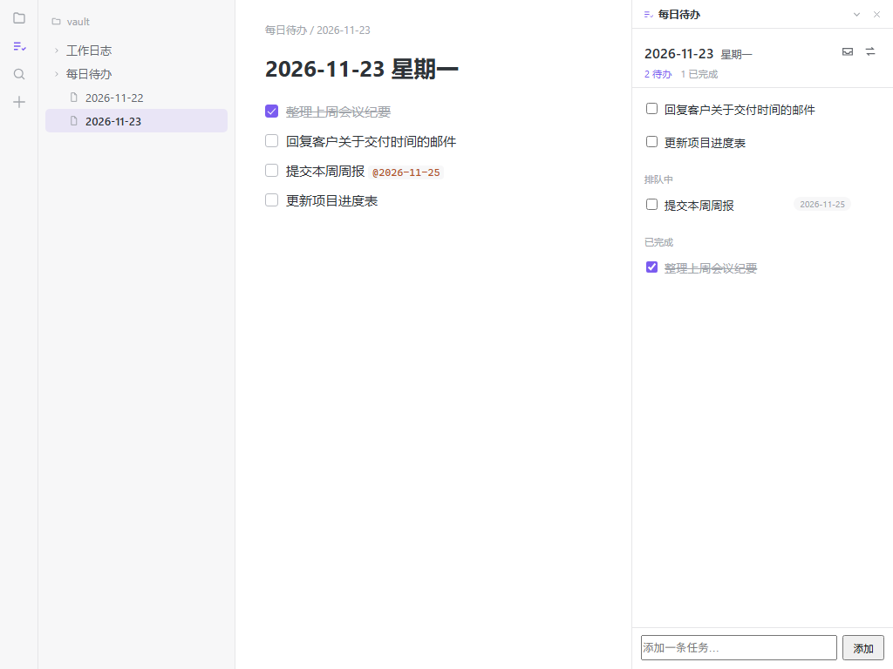

# Daily Todo Panel

A daily checklist that lives inside your vault. One note per day, unfinished items roll over automatically, and open tasks can be pulled in from your work log.



*Screenshot rendered from the plugin's own stylesheet.*

## Features

- **One list per day** — `每日待办/2026-11-23.md` (folder is configurable), created on demand.
- **Automatic rollover** — unfinished tasks from the previous list are moved into today. The old note keeps only completed items, so it doubles as an archive.
- **Pull tasks from your work log** — any open `- [ ]` item in recent notes of your work log folder is copied into today's list. Copies are de-duplicated, so a task never shows up twice.
- **Check it off anywhere** — ticking a box in the panel rewrites the matching line in the note. Desktop and mobile share the same file.
- **Defer with a marker** — append `@+2d`, `@11-24` or `@2026-12-01` to keep a task out of the way until it is due. Deferring from the panel writes an absolute date, so it never drifts.
- **Works on mobile** — the panel is a regular sidebar view, no desktop-only APIs. `isDesktopOnly` is `false`.

## Install

Community plugins → Browse → search **Daily Todo Panel** → Install → Enable.

Manual install: copy `main.js`, `manifest.json` and `styles.css` into `<vault>/.obsidian/plugins/daily-todo-inline/`, then enable the plugin in settings.

## Usage

1. Click the checklist icon in the ribbon, or run **Open daily todo panel** from the command palette.
2. Today's note is created and unfinished tasks from your last list are carried over.
3. Tick a task to complete it. The line in the note becomes `- [x]`.
4. To add something quickly, type in the field at the bottom of the panel and press Enter.

Only real task list items are picked up from the work log:

```markdown
- [ ] Reply to the customer's delivery email
- [ ] Tidy last week's meeting notes
- [x] Completed items are ignored
```

### Defer syntax

The marker is only matched at the end of a task, so an `@` inside the text is safe:

```markdown
- [ ] Send the weekly report @+2d          ← in two days
- [ ] Book a health check @11-24           ← November 24 this year
- [ ] Renew a document @2026-12-01         ← full date
```

Tasks with a future date move to the **Queued** section until they are due. The `⋯` button next to a task opens the same options and writes a concrete date into the note.

## Settings

| Setting | Default | Description |
| --- | --- | --- |
| List folder | `Daily Todo` | Where daily notes are stored. |
| Work log folder | `Work Log` | Open tasks are pulled from recent notes here. |
| Look-back days | `2` | Only notes modified within this many days are scanned. |
| Carry over on open | on | Bring unfinished tasks from the previous list into today. |
| Extract on open | on | Pull new open tasks from the work log when the panel opens. |
| Show completed | on | List today's completed tasks at the bottom of the panel. |

Folders default to Chinese names (`每日待办` / `工作日志`) when the app language is Chinese.

## Notes and limits

- Plain paragraphs in the work log are never treated as tasks; they must be `- [ ]` list items.
- Extraction copies, it does not move. The original line in your work log is left untouched.
- A day only gets a list if you open the panel that day. Rollover then starts from the most recent existing list.
- Tasks are matched by text when de-duplicating, so two identical task titles are treated as one.
- The plugin only touches Markdown files inside the folders you configure. No network requests, no telemetry.

## Development

```bash
npm install
npm run dev      # watch mode, rebuilds main.js
npm run build    # production build + type check
```

Copy `main.js`, `manifest.json` and `styles.css` into `<vault>/.obsidian/plugins/daily-todo-inline/` and reload the plugin.

## Support

If this plugin saves you some time, you can buy me a coffee.

<p align="center">
  
</p>

A rating in the community directory or an issue report is just as welcome.

## License

MIT
